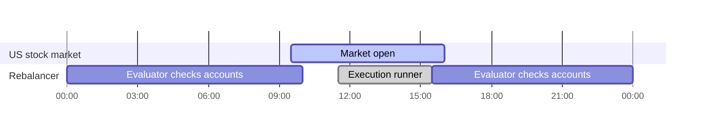

# Automated Rebalancing

Alpaca's Portfolio Rebalancing service lets you offer model portfolios to your end customers and keep their brokerage accounts aligned with those models automatically. You define target allocations, connect customer accounts to a model, and Alpaca monitors when rebalancing is needed and places the trades on your behalf.

This guide explains how rebalancing works, the core concepts, and how to integrate it into your product. For request/response schemas and endpoint details, see the [Rebalancing API reference](/us/reference/get-v1-rebalancing-portfolios).

<Callout icon="🚧" theme="info">
  Rebalancing must be enabled for your correspondent. Contact your Alpaca representative to enable rebalancing on your account.
</Callout>

# What is portfolio rebalancing?

A model portfolio is a target mix of assets such as 60% SPY, 35% TLT, and 5% cash. Over time, market movements, deposits, and withdrawals cause an account's actual holdings to drift away from that target.

Rebalancing is the process of buying and selling to bring the account back in line. A rebalancer automates that work: it watches subscribed accounts, decides when action is needed, calculates the required trades, and automatically creates orders.

Common use cases include:

* **Robo-advisory**: customers pick a strategy; the platform keeps them invested on schedule.
* **Managed portfolios**: advisors publish models; client accounts follow them.
* **Goal-based investing**: accounts stay aligned with a glide path or asset allocation.
* **Cash management**: excess cash from deposits or dividends is invested without a full rebalance.

# Product compatibility

| Setup           | US Equities | Non-US Equities | Fixed Income | Crypto |
| --------------- | ----------- | --------------- | ------------ | ------ |
| Fully Disclosed | ✅           | ❌               | ❌            | ❌      |
| Omnisub         | ❌           | ❌               | ❌            | ❌      |
| Omnibus         | ❌           | ❌               | ❌            | ❌      |

# How it works

At a high level, the rebalancer follows a simple pattern:

1. [**You create a portfolio**](/us/reference/post-v1-rebalancing-portfolios): a named model with target weights and optional trigger rules.
2. [**You subscribe customer accounts**](/us/reference/post-v1-rebalancing-subscriptions): each account is linked to exactly one portfolio.
3. **An evaluator monitors accounts**: on trading days, it checks whether any trigger conditions are met.
4. **A rebalance run is queued**: when action is needed, a rebalance run is queued for that account.
5. **A runner executes the run**: during market hours, it calculates orders, submits them, and records the outcome.

<Recipe slug="setup-automatic-rebalancing-on-an-account" title="Setup Automatic Rebalancing on an Account" />

# Timing and market hours

Automatic rebalancing respects US equity market hours (Eastern Time).

## Evaluator

The evaluator is the monitoring service. It watches subscribed accounts and decides if a rebalance should happen, checking drift, calendar schedules, portfolio updates, and cooldown rules against each portfolio's configuration.

* Runs only on trading days (not weekends or market holidays).
* Runs when the market is closed and within the first 30 minutes and last 30 minutes of the market session.
* Does not queue runs on days the market is closed.

## Runner

The runner is the execution service. It takes queued rebalance runs and carries them out, calculating the required trades, submitting orders, and recording results.

* Rebalancing runs are executed between 11:30 ET and 15:30 ET.
* Processes runs in a randomised order for fair distribution across your accounts.
* Queued runs wait until the execution window opens, regardless of whether they were created by the evaluator, a subscription, or your API call.

 

 

 

***

*Any symbols or examples shown are for demonstration purposes only and do not constitute investment advice or a recommendation to buy or sell any security.*

 